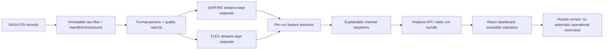

# Phase two: data processing and anomaly-model architecture

## Goal

Turn NASA PSI combustion telemetry into traceable, experiment-aware indicators that help a human inspect possible fire growth, sensor faults, and extinction behavior. FlameScope is a research demonstrator. It is not a spacecraft alarm, a certified safety system, or a substitute for NASA operating procedures.

## Phase-two processing completed

The first slice is from [SAFFIRE-I / PSI-98](https://psi.nasa.gov/physci/repo/data/investigations/PSI-98) and [FLEX / PSI-69](https://psi.nasa.gov/physci/repo/data/investigations/PSI-69). NASA describes SAFFIRE-I as a large fabric-fire experiment in a duct with optical, thermal, gas, pressure, and flow measurements. FLEX records droplet burning/extinction behavior and controlled ambient/suppressant conditions. PSI requires attribution by the investigation's persistent identifier; provenance is stored with the files.

### SAFFIRE-I

The workbook parser exports three sheets to separate CSVs:

| Sheet | Rows retained | Rows excluded | Time handling |
|---|---:|---:|---|
| `RawData` | 2,645 | 7,104 | `RelativeSeconds` values preserved as source values; units unresolved |
| `CygnusData` | 2,540 | 5,532 | `CygnusTimestamp` plus source-labeled `Relative Time (s)` |
| `SaffireData` | 105 | 5,978 | `SaffireTimestamp` plus source-labeled `Relative Time (s)` |

Rows without usable source time were excluded from the derived exports. Two Excel error cells in `RawData` were converted to blanks and flagged. The Cygnus and SAFFIRE tables have distinct timestamp columns and very different observed cadences, so they remain separate. `RawData` calls its time field `RelativeSeconds`, while the values are on a different scale from adjacent millisecond/seconds fields; the pipeline does not convert that field or treat it as seconds. Sensor values and peaks are preserved without smoothing, outlier removal, or calibration.

### FLEX-007

The test sheet maps run `FLEX-007` to CIR test `20CAL13`. Three independent, approximately 30 Hz streams were cleaned while preserving their original time columns:

| Stream | Rows | Source time coverage |
|---|---:|---:|
| Droplet | 141 | -1.467 to 3.900 s |
| LLUV flame imaging | 177 | -0.550 to 5.517 s |
| Color camera | 158 | 0.233 to 5.633 s |

The test sheet reports heptane, 1.00 atm, O2/N2 mole fractions of 0.21/0.79, an initial droplet diameter of 1.82 mm, and an end state of disruption. The experiment table reports the matching `20CAL13` identifier with its own values and precision. Both source versions remain visible; the pipeline does not silently reconcile them. Time series are not joined by row number or resampled.

Rebuild these derivatives from the repository root:

```powershell
node processing/prepare_saffire_telemetry.mjs
node processing/prepare_flex007.mjs
```

The generated quality reports document retained/dropped rows, missing values, error cells, time ranges, and cadence. Original downloads remain unmodified in `data/raw/`; sources, versions, and checksums are recorded in the manifest and file inventory. NASA's [PSI data guide](https://science.nasa.gov/wp-content/uploads/2024/11/psi-database-guide.pdf) explains PSI file organization and selected-file downloads.

## System architecture



### 1. Ingestion and provenance

- Keep each PSI original immutable. Record DOI, record version, file version, original name, PSI storage key, retrieval date, byte count, and SHA-256.
- Use a stable record/download endpoint in provenance, not a temporary signed storage URL.
- Parse each source into its own run/stream table. Carry `psi_record_id`, DOI, run ID, source file, source sheet/file row, original channel name, original unit, and quality flags into every derived observation.
- Preserve source-reported metadata separately from measured samples. Never fill a condition from a different source silently.

### 2. Cleaning and time integrity

- Decode file formats, normalize line endings/delimiters, and keep original channel labels.
- Convert known Excel error tokens to blank only in curated outputs; retain the source row and report the error.
- Exclude records without a valid source timestamp from time-series modeling; count them in the quality report.
- Preserve sensor spikes and irregular intervals. They may be combustion behavior. Only a documented sensor/data error can justify dropping a measurement.
- Keep clocks and sampling cadences separate. Build a clock map only from documented timestamp pairs. Any later nearest-time join must specify a maximum tolerance and show unpaired samples; no implicit interpolation across gaps.
- Exclude `RawData.RelativeSeconds` from time-based features until its units are resolved.
- Keep channels in instrument units until calibration documents establish physical conversions. In particular, detector/radiometer channel values are not automatically optical density or heat flux.

### 3. Feature layer

Compute features independently per run and per channel using timestamped windows. Preserve the raw value alongside every feature.

**SAFFIRE candidates**

- Robust rolling baseline deviation and first derivative for source-labeled smoke obscuration/scatterometer voltage, temperature, pressure, fan differential pressure, and radiometer channels.
- Cross-sensor concurrence after clocks are reconciled: for example, a sustained detector change with a temperature/radiation change is stronger evidence than one isolated voltage spike.
- Motion/acceleration features can explain disturbances and help distinguish sensor movement from fire-related change.

**FLEX candidates**

- Droplet diameter trend and interval-specific d-squared slope as a burning-rate feature, only after the burn segment and time origin are verified.
- Flame diameter, flame stand-off, and droplet diameter trends from each camera stream, retaining each camera's source clock.
- Test conditions (fuel, pressure, O2 and suppressant fractions) are context variables, not time-varying sensors.

SAFFIRE is a large solid-fabric fire in a duct; FLEX is a liquid-droplet experiment. Their feature sets and detectors stay study-specific unless NASA documentation supports a well-defined shared variable and conversion.

### 4. Model stack

**Challenge MVP: explainable anomaly indicators**

1. Build a per-channel baseline from verified, non-event segments within the same run or a matched set of runs.
2. Calculate rolling median and median absolute deviation (MAD), plus a robust slope/change feature. Flag a channel deviation only when it persists for a configured number of valid samples; show the actual values and window.
3. Combine only synchronized channels. A transparent evidence score can count independent corroborating indicators; do not label it a calibrated probability.
4. Emit one of `data_quality_issue`, `single_sensor_deviation`, `multi_sensor_change`, or a source-reported experiment outcome such as `disruption`. Keep those meanings distinct.
5. Return evidence with each flag: channel, value/unit, baseline window, deviation, source row range, time basis, run conditions, and quality notes.

This baseline can surface unusual behavior. It cannot predict a fire event from the current sample, and it must not be described as an operational alarm.

**Later model, after more labeled runs exist**

- Establish an event timeline from source documents and subject-matter review: normal baseline, ignition, sustained growth, detector response, extinction/disruption, and sensor/data fault. Mark uncertain boundaries as uncertain.
- Compare robust statistical baselines with an isolation forest or a small gradient-boosted classifier. Avoid a deep temporal network until there are enough independent runs.
- Split by entire run/test ID, never random rows. Hold out complete runs and, where possible, one experiment campaign. This prevents adjacent time samples from leaking between training and evaluation.
- Report precision/recall, PR-AUC, false flags per hour, event lead time, and calibration when probabilities are produced. Compare against simple threshold and robust-z-score baselines.
- Evaluate across runs before cross-study transfer. A model trained on one sensor layout or fuel must not be presented as general spacecraft fire safety.

### 5. API and dashboard

For a challenge demo, the frontend can load versioned JSON/CSV bundles generated by the processing scripts. A later Python model service can expose:

- `GET /api/runs` — available investigations, runs, source versions, and quality status.
- `GET /api/runs/{run_id}/series` — observations and source-linked channel metadata.
- `POST /api/runs/{run_id}/analyze` — indicators for a selected window with thresholds/model version.

The React dashboard should show per-stream plots, run conditions, quality warnings, and clickable provenance. Keep experiment filters explicit. For an indicator, display what changed, the supporting channels, time window, missing/gap status, and why the current evidence is insufficient. Do not present a red/green “safe/unsafe” verdict.

### 6. Physics and quantum-computing research path

Use physical context to constrain feature design and interpretation, not to decorate an opaque model. FLEX droplet burning trends can be compared with the d-squared-law regime when test phases and units are verified. SAFFIRE detector, temperature, radiometer, and flow channels can be checked for physically consistent timing and response. Each constraint must cite the source assumptions and applicable experiment conditions.

For the AI/physics/quantum-computing goal, first establish a reproducible classical baseline and a run-level evaluation. A later research experiment could compare a quantum-kernel feature map on a small, carefully selected window-feature set against classical kernels under the same held-out-run protocol. Do not claim quantum advantage unless the experiment demonstrates it against matched classical baselines with adequate data and uncertainty analysis.

## Current evidence limits and next data work

- One FLEX-007 test and one SAFFIRE-I workbook are too little to train or validate a general predictive model.
- The current files provide time series and test conditions, but not a complete, independently verified anomaly-label set.
- SAFFIRE channel calibration and the `RawData.RelativeSeconds` unit ambiguity need to be resolved from supporting documentation before physical conversions or cross-clock joins.
- Retrieve additional PSI runs only after choosing the target event and confirming each run's file structure, calibration, test conditions, and data rights. NASA's [PSI-98](https://psi.nasa.gov/physci/repo/data/investigations/PSI-98) and [PSI-69](https://psi.nasa.gov/physci/repo/data/investigations/PSI-69) pages link the source data and investigation documentation.
